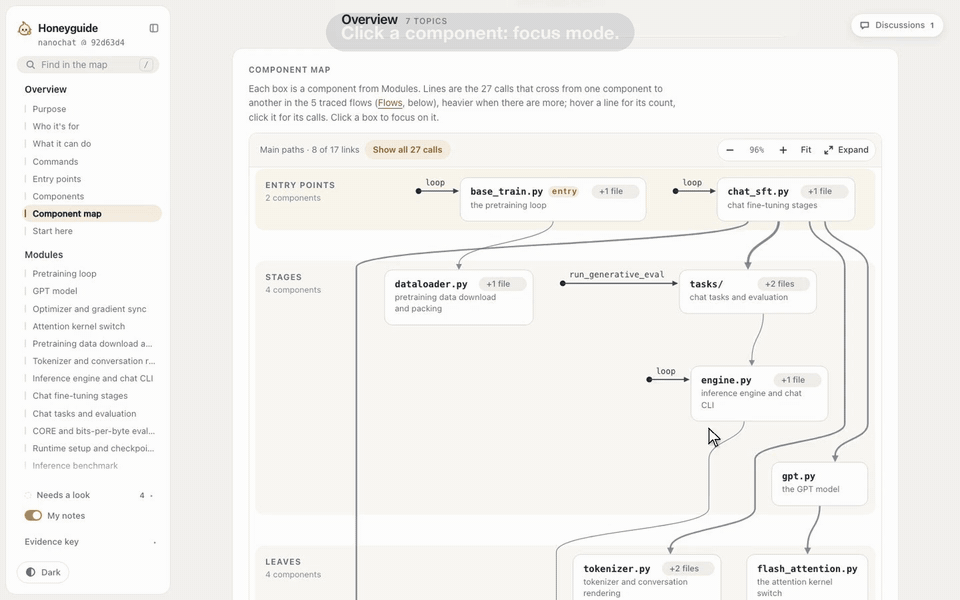
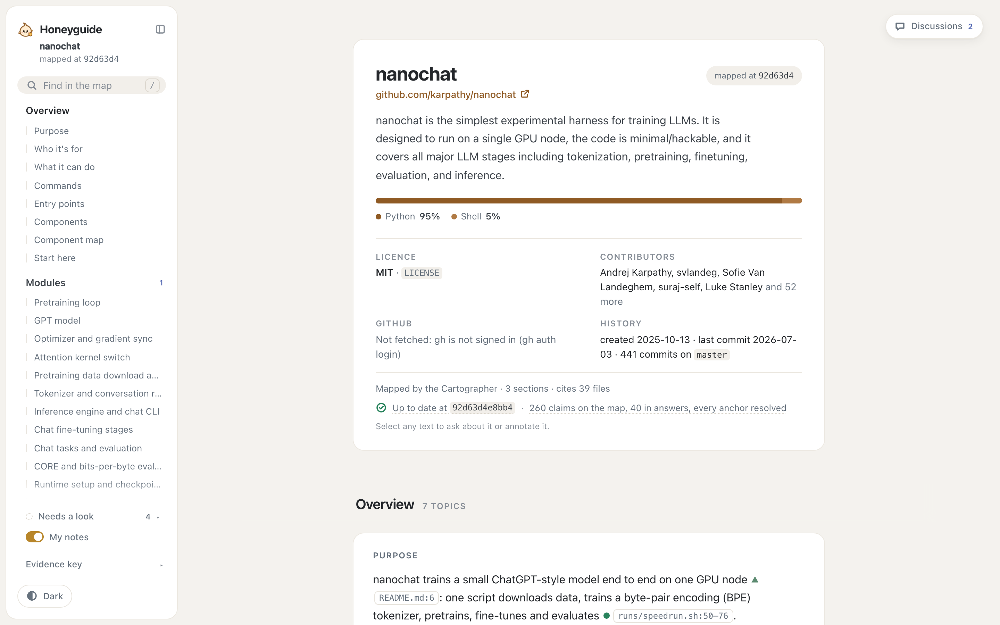

<p align="center">
  <picture>
    <source media="(prefers-color-scheme: dark)" srcset="assets/logo-dark.svg">
    
  </picture>
</p>

# Honeyguide

**When agents write the code, who maintains the understanding of it?**

Coding agents make writing code cheaper. Someone still has to know how the code works, check that what they
know is true, and keep it current as the code changes. Today most of that understanding lives in private
chats. Each engineer's agent works out the same code again, nobody checks the answer, and nobody keeps it
current.

Honeyguide keeps that understanding as a record you can check. It is a Claude Code plugin with four
subagents. It builds a map of a repo that you read in your browser and ask questions on:

- every claim on the map cites the source lines it comes from;
- a separate Checker reads those lines against the claim;
- a repair pass fixes or retires the claims the Checker turns down;
- when the code changes, a refresh updates only what changed.

The map records what is believed about the code, why (the citations, an evidence label, the Checker's
verdict), and when to look at it again (each claim is current, stale or retired).

**What is measured and what isn't.** The checking and the refresh are measured, on two Python repos. The
first hypothesis, that a map makes an agent answer more accurately, was not supported on the repo tested.
Sharing one map across a team is the aim. It isn't built yet: today Honeyguide is single-user and local.
Whether it saves a team time is untested.

Honeyguide is a side project I built to learn how to design and build agentic workflows, not a product.

The write-up: [Honeyguide: who maintains the understanding when agents write the code?](https://bearbearyu1223.github.io/posts/honeyguide-agent-that-learns-a-codebase/)



The full demo (about 2 minutes) is [demo/honeyguide-demo.mp4](demo/honeyguide-demo.mp4).
[demo/README.md](demo/README.md) says how it was recorded: real runs on the real page, with the sped-up waits
marked on screen.

<p align="center">
  <picture>
    <source media="(prefers-color-scheme: dark)" srcset="docs/images/nanochat-top-dark.png">
    
  </picture>
</p>

## What I found

Each number links to the line of the results file in [`outputs/`](outputs/) it comes from.

- **The map didn't make answers measurably more accurate.** In a 20-question pilot on nanochat, map minus
  explore (an agent searching the code with no map) was +0.022, 95% CI [-0.010, +0.075]
  ([eval_pilot_nanochat.txt](outputs/eval_pilot_nanochat.txt#L57)).
- **Ad-hoc answers weren't measurably worse.** A Checker that finds its own evidence judged 0.020 (2.0%) of
  the claims in the pilot's ad-hoc answers not supported or wrong, against 0.010 (1.0%) of a map's unchecked
  claims. The difference is +0.010, 95% CI [-0.016, +0.033], which spans 0
  ([adhoc_check.txt](outputs/adhoc_check.txt#L36-L43)).
- **A refresh costs a fraction of a rebuild.** After an ordinary day on waku-agent, a refresh cost 0.20 to
  0.26 of a rebuild at list price, about a fifth to a quarter
  ([refresh.txt](outputs/refresh.txt#L134-L138)). Across nanochat's 60-commit rewrite it cost 0.51, about
  half ([refresh.txt](outputs/refresh.txt#L103)).
- **The Checker mostly catches citations that are too narrow, and it passed one wrong value.** Before any
  repair it turned down 102 of 260 claims on nanochat's map ([runs.txt](outputs/runs.txt#L114)). In the first
  repair round, 85 of them kept their words and got citations that cover more lines
  ([runs.txt](outputs/runs.txt#L124)).
  It also passed a claim that an attention window is 768 tokens, where the code gives 512
  ([runs.txt](outputs/runs.txt#L260-L291)).

Limits: one person, one model, two small-to-medium Python repos, and no team study (see
[Limits and what's next](#limits-and-whats-next)).

## Requirements

- Claude Code, on a subscription or an API key. Use a recent version, because the Guide uses plugins and the
  Monitor tool.
- Python 3.10 or newer. The CLI uses the standard library only.
- [uv](https://docs.astral.sh/uv/) (or pipx), to install the CLI.
- git.
- Optional: the GitHub CLI (`gh`), signed in, for stars, forks and open issues on the repo card.
- macOS or Linux.
- A git checkout of the repo you want to map. Honeyguide reads committed code only, so text that exists only
  in uncommitted edits can't be cited.

## Install

**1. The CLI.** Get a copy of Honeyguide, then install the `honeyguide` command from it:

```bash
git clone https://github.com/bearbearyu1223/honeyguide ~/honeyguide
uv tool install --editable ~/honeyguide
honeyguide --help
```

With pipx instead of uv: `pipx install --editable ~/honeyguide`.

If the command isn't on your PATH, the Guide falls back to `uv run --project <plugin dir> honeyguide`. That
works, but the permission rule below won't match it, so you'll be asked to approve every call.

**2. The plugin.** The repo is its own plugin marketplace. In Claude Code:

```
/plugin marketplace add bearbearyu1223/honeyguide
/plugin install honeyguide@honeyguide
```

To run the plugin from your clone instead (for example, to try your own changes), add it by path:
`/plugin marketplace add /absolute/path/to/honeyguide`.

Or add it to `~/.claude/settings.json` yourself, and restart Claude Code:

```json
{
  "extraKnownMarketplaces": {
    "honeyguide": {"source": {"source": "github", "repo": "bearbearyu1223/honeyguide"}}
  },
  "enabledPlugins": {"honeyguide@honeyguide": true}
}
```

## Permissions

A run calls the `honeyguide` command many times, and the Cartographer writes its draft map as files under
`~/.honeyguide/`. Allow both, or Claude Code will stop to ask each time. Add this to `~/.claude/settings.json`
(or to the mapped repo's `.claude/settings.json`):

```json
{
  "permissions": {
    "allow": [
      "Bash(honeyguide:*)",
      "Edit(~/.honeyguide/**)"
    ]
  }
}
```

- `Bash(honeyguide:*)` allows commands that start with `honeyguide`, and nothing else.
- `Edit(~/.honeyguide/**)` allows file writes under `~/.honeyguide/` only. In Claude Code, `Edit` rules cover
  every tool that writes files, including `Write`. A path starting with `~/` is in your home directory.
- If you set `HONEYGUIDE_HOME`, use that path instead of `~/.honeyguide`.

- A command chained with `&&`, `;` or `|` is allowed only if every part is, so a rule for `honeyguide` doesn't
  let anything else ride along.

Claude Code will still ask before a few other steps, such as opening the page in your browser. The rule syntax is
described in Claude Code's [permissions](https://code.claude.com/docs/en/permissions) docs.

## Quick start

1. Go to the repo you want to learn, and start Claude Code:

   ```bash
   cd ~/code/some-repo
   claude
   ```

2. Ask the Guide to explore it:

   ```
   /honeyguide:honeyguide explore
   ```

   The Cartographer reads the code and writes the map: the repo card, an Overview, the Modules, and three to
   five Flows. Every factual sentence is a claim that cites its lines. Then the Checker re-reads each claim
   against those lines, and the repair pass fixes or retires the claims it flagged (see
   [How it stays honest](#how-it-stays-honest)). For a mid-size repo this takes tens of minutes, and it uses
   your Claude usage. On nanochat and waku-agent the latest maps took 31 and 35 minutes, and their repair
   passes another 15 and 6.

   Optional: for GitHub stars, forks and open issues on the repo card, sign the GitHub CLI in once
   (`gh auth login`) before exploring. To refresh the card later (after signing in, or when the numbers are
   old), run `honeyguide repo-info --repo . --save`. The page itself never fetches anything.

3. The map opens in your browser at `http://127.0.0.1:8780`. Select any text and choose **Ask** to ask a
   question, or **Annotate** to write a note (private unless you tick "Share with agents"). Back in Claude
   Code, the Guide sees the question and hands it to an Investigator, or to the Tracer for "what happens
   when ..." questions. The answer appears beside your selection, then the Checker checks its claims and
   the repair pass fixes the ones it flagged.
   Keep the Claude Code session open while you use the page: the page never starts Claude by itself.

4. When the code changes, commit, then run:

   ```
   /honeyguide:honeyguide refresh
   ```

   Claims whose lines only moved follow them. Claims whose lines changed are marked stale and re-checked.
   Claims whose code is gone are retired. Only new code is mapped.

Other commands:

| command | what it does |
|---|---|
| `/honeyguide:honeyguide open` | serves the saved map, opens it, and starts answering questions |
| `/honeyguide:honeyguide watch` | starts answering questions again, when the page is already open |
| `/honeyguide:honeyguide start over` | maps the repo again from scratch and replaces the map |
| `/honeyguide:honeyguide` | picks for you: explore if there is no map, refresh if the code moved on, otherwise open |

## What you see on the page

- **Repo card**: the link, the README's description line, languages (by lines of source), licence, top
  contributors (names only), history, the commit the map was made at, and GitHub stars, forks and open issues
  with the date they were read (only when `gh` was signed in). These facts come from git and the GitHub CLI,
  not from the agents.
- **Outline and Find**: the left side lists every section, Overview topic, module and flow, and marks the one
  you are reading as you scroll. Press `/` to find text in the map.
- **Overview**: what the repo is for, who it's for, what it can do, its commands and entry points, its
  components, and where to start reading.
- **Component map**: the components in three bands (entry points, stages, leaves), with the main call paths
  shown and "Show all" for the rest. Click a component to focus it and its callers and callees; its card has
  **Ask about this component**, which opens a question about it, ready to send.
- **Modules**: one card per component, with its files, its job, and why it is built that way.
- **Flows**: real workflows followed call by call, drawn as swimlane diagrams or read as a list of steps.
- **Diagrams**: every diagram zooms (the buttons, `+` / `-`, or Ctrl/Cmd + scroll), pans by dragging, fits,
  and opens full screen.
- **Evidence marks**: a shape beside each claim says where it comes from: read in source, asserted by a
  test, docs, seen at runtime, inferred, searched and not found, or general knowledge. A check mark means the
  Checker re-read the cited lines and they support the claim. A claim they don't fully support keeps a quiet
  mark; hover it for the Checker's note.
- **Needs a look**: the side lists the claims still flagged after the repair pass. Click one to jump to it.
- **Code previews**: click a citation to see its lines. A GitHub link opens them pinned to the commit (when
  that commit is on a GitHub remote), and another link opens them in your editor.
- **Avatars**: Honey, the Guide, and the four agents (Cartographer, Investigator, Tracer, Checker) appear
  beside whatever they are working on.

## How it stays honest

A claim on the map can be trusted at three levels, and Honeyguide guards them differently:

1. **The citation points at real lines.** A script checks this, never the agent. The agent quotes the lines
   it means, and the script finds them at the map's commit and records the line range and a hash. A quote
   that can't be found, or turns up twice, is refused.
2. **The lines support the claim.** The Checker judges this. Most of what it turns down is true but cites too
   few lines.
3. **The claim is correct.** Nothing guarantees this. On nanochat the Checker passed a claim that an
   attention window is 768 tokens, because a stale comment on the cited line said 768. The code on that line
   gives 512 ([runs.txt](outputs/runs.txt#L260-L291)). The Checker's rule is now "compute, don't quote", and
   it can still miss things: it is Claude checking Claude.

How each guard works:

- Every factual sentence is a claim that cites lines at a commit. A claim not read straight from the code
  says how it was reached (inferred, searched and not found, or general knowledge).
- The Checker re-reads the cited lines for each claim. For a value (a number, a default, a size) it works the
  value out from the code; a comment or docstring backs a claim only when the claim says it reports the docs.
- The repair pass gives each flagged claim to the agent that wrote it, with the Checker's note. The agent widens
  the cited lines, narrows the sentence, or retires the claim, and the Checker checks the fix. A claim gets at
  most two rounds per pass.
- What is still flagged after that stays on the map with a quiet mark and is listed under **Needs a look**.
- Nothing claims a run that didn't happen. Your code runs only if you approve a runtime trace for the
  Tracer. Otherwise a flow's steps say "read in source, not run", and only a step found in such a trace is
  ever marked seen at runtime.

**The refresh gap.** A refresh flags a claim when its cited lines change. A claim whose cited lines only
moved, or that cites no code at all, keeps its status even when the code around it changes, so it can go
stale unnoticed until a re-map reads that code again. In the nanochat refresh, the re-map later retired 3
moved claims and 6 of the 12 claims that cite no code ([refresh.txt](outputs/refresh.txt#L57),
[refresh.txt](outputs/refresh.txt#L157-L158)).

## Limits and what's next

**Limits.**

- Single-user and local. The map lives on the machine that built it, and the page is served only there.
- Tested on two small-to-medium Python repos, nanochat and waku-agent. The accuracy pilot ran on nanochat
  only, with 20 questions.
- One model, Claude Opus 5.5, built the maps, answered the questions and ran the Checker.
- No team study. Nobody else has used these maps, so reuse, adoption and time saved are untested.

**Next.**

- **Sharing**: a static export of the map, with its citations, checks and answers, that a team can commit
  next to the code or host.
- **Reviewable knowledge updates**: when a pull request changes code, propose the matching change to the
  map's claims (old claim, new claim, the source lines) for review alongside the code.
- **A team study**: engineers new to a repo, on overlapping tasks, with and without Honeyguide.
- **A map health check**: generate questions with keys from the code, answer them from the map and score them
  by script, to show where a map is thin.
- **Closing the refresh gap**: re-check claims that cite no code, and claims about the repo as a whole, on
  every refresh.

## Where things are stored

Everything goes in `~/.honeyguide/<repo id>/` (or `$HONEYGUIDE_HOME/<repo id>/`). Nothing is written into
your repo. The repo id comes from the remote URL and the first commit, so any checkout of the same repo finds
the same map.

```bash
honeyguide status --repo .                       # the map's commit vs HEAD, and counts
honeyguide export --repo . -o honeyguide.json    # everything in one file (private notes left out)
honeyguide import --repo . honeyguide.json       # merge an export into this repo's memory
```

**Privacy.** The page server listens on `127.0.0.1` only. Every API request needs a token that is embedded in
the page and stored in the memory folder, readable only by you. The page loads nothing from the network. Your
code goes only to Claude, through your own Claude Code session.

## Troubleshooting

- **"can't serve on 127.0.0.1:8780"**: something else is using the port, often another repo's map. Ask the
  Guide to open the map on another port (it runs `honeyguide serve --port 8781`), or stop the other server.
- **A question stays "waiting"**: no session is watching for questions. Run `/honeyguide:honeyguide watch`
  in a Claude Code session in that repo. Questions asked in the meantime are picked up then.
- **Permission prompts during a run**: check the permissions block above. The CLI must be on your PATH
  (`command -v honeyguide`) for `Bash(honeyguide:*)` to match.
- **The map was refused** (`validation_failed`, often a readability error such as "telegraph style"): the
  Cartographer fixes the errors and tries again, and drops the claims it can't fix after three rounds. If the
  map still isn't saved, nothing was written. Run explore again, or give it a narrower focus, such as
  `/honeyguide:honeyguide explore only the training path`. `honeyguide map validate --repo .` lists the saved
  map's problems.
- **A claim is marked stale**: the code it cites changed after the map was made. Run
  `/honeyguide:honeyguide refresh`.
- **Claims listed under "Needs a look"**: the Checker still found them not fully backed by their lines after
  two repair rounds. Hover a claim's mark for the Checker's note, then read the cited lines yourself or select the claim and
  ask about it.
- **GitHub numbers missing on the repo card** ("Not fetched: gh is not signed in"): the GitHub CLI wasn't
  signed in when the card was made. Run `gh auth login`, then `honeyguide repo-info --repo . --save`, and
  reload the page.

## For contributors

### What works

- The memory store, code anchors, the refresh classifier and retrieval (`docs/design/memory-and-anchors.md`).
- The `honeyguide` CLI, the question inbox, the page server and the watcher (`docs/design/agent-contract.md`).
- The plugin: the Guide skill and four subagents (`skills/`, `agents/`), run end to end on nanochat and waku-agent.
- The map as draft files, checked before it is saved, including a readability check.
- The repair pass for map claims and for answers (two rounds per pass), and "Needs a look".
- The Checker's "compute, don't quote" rule, and one `honeyguide` command per Bash call.
- Refresh applied to the saved map: `refresh apply`, the stale re-check, `claims retire`.
- The map page: repo card (`repo-info`), outline and Find, Overview topics, component modules, the component map
  with focus and Ask, flow swimlanes, and zoom, pan and full screen on every diagram (`docs/design/ux-v4.md`).
- Honey and the agent avatars, and the demo video (`demo/README.md`).

### Not built yet

- Runtime confirmation of flow hops in the product. `eval/trace/` is the eval's own trace, not part of the plugin.
- Sharing a map with a team (a static export of the page). The map is local to one machine.

### Tests

```bash
uv run pytest -q
```

The browser tests need Google Chrome and skip without it. Tests that need the eval's target clones or run archives
skip when those aren't present.

### The eval

The eval asks whether the map helps an agent answer, how well the checking works, and what keeping a map
current costs. `eval/pilot/` isolates a Claude Code run from your settings and memory. `eval/questions/` holds
the question sets and answer keys for nanochat and waku-agent, and `eval/trace/` captures runtime traces of
their flows. `eval/adhoc/` checks ad-hoc answers and a sample of map claims with the same Checker.
`eval/refresh/` captures two refreshes and compares their cost with a rebuild. `eval/runs/` reads the saved
records of the map builds, the Checker and the repair passes. `eval/run/` is the runner for the four-way test (no
access, explore, outline, map), and `eval/score/` is the scorer that prints `outputs/eval_pilot_nanochat.txt`.
`eval/human/answers/` holds the annotator's decisions that the scorer reads (disputed callers, flow hops, and the
why/how questions with their rubrics). `eval/cutoff/` counts the answer keys' lines last changed in June 2026, the
model's training-cutoff month, and `eval/figures/` draws the post's figures from the files in `outputs/`.

Target repos are cloned outside this repo. Regenerating `outputs/` needs those clones and the run archives (the
saved transcripts, maps and results of each run), which aren't in the repo.

Captured output is in `outputs/`. The results files behind [What I found](#what-i-found):

| file | what it holds |
|---|---|
| [`outputs/eval_pilot_nanochat.txt`](outputs/eval_pilot_nanochat.txt) | the 20-question pilot on nanochat: no access, explore, outline and map, with paired differences and cost |
| [`outputs/adhoc_check.txt`](outputs/adhoc_check.txt) | ad-hoc answers against map claims, judged by one Checker |
| [`outputs/refresh.txt`](outputs/refresh.txt) | refresh against rebuild: nanochat across a 60-commit rewrite, waku-agent after an ordinary day |
| [`outputs/runs.txt`](outputs/runs.txt) | the map builds: Checker verdicts, repair rounds and the "compute, don't quote" re-check |

### Folders

`.claude-plugin/`, `skills/`, `agents/` (the plugin), `src/honeyguide/` (the CLI and page server),
`docs/design/` (data model, contract, UX v4), `docs/images/` (screenshots), `assets/` (logo, Honey, avatars),
`demo/` (the demo video and how it was made), `eval/`, `outputs/`, `tests/`.

## License

MIT. See [LICENSE](LICENSE).
