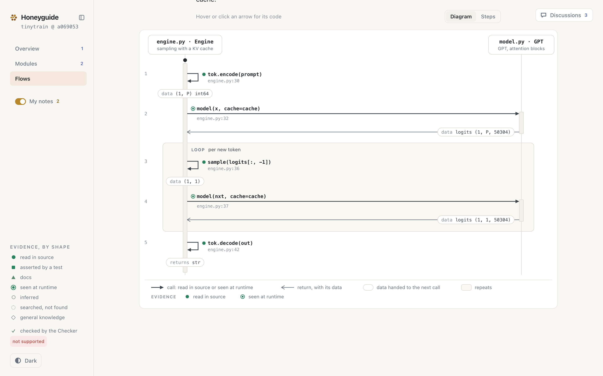

<p align="center">
  <picture>
    <source media="(prefers-color-scheme: dark)" srcset="assets/logo-dark.svg">
    
  </picture>
</p>

# Honeyguide

Honeyguide is a set of Claude Code subagents that learn a repository into a map you read in your browser and
ask questions on. Every sentence in the map cites the lines of code it comes from.

<p align="center">
  <picture>
    <source media="(prefers-color-scheme: dark)" srcset="docs/screens/t7.4/flow-generate-dark.png">
    
  </picture>
</p>

Honeyguide is a work in progress. It has mapped two real repos so far, nanochat and waku-agent.

## Requirements

- Claude Code, on a subscription or an API key. Use a recent version, because the Guide uses plugins and the
  Monitor tool.
- Python 3.10 or newer. The CLI uses the standard library only.
- [uv](https://docs.astral.sh/uv/) (or pipx), to install the CLI.
- git.
- macOS or Linux.
- A git checkout of the repo you want to map. Honeyguide reads committed code only, so text that exists only
  in uncommitted edits can't be cited.

## Install

**1. The CLI.** Get a copy of Honeyguide, then install the `honeyguide` command from it:

```bash
git clone https://github.com/bearbearyu1223/honeyguide ~/honeyguide   # once the repo is public
uv tool install --editable ~/honeyguide
honeyguide --help
```

Until the repo is public, use the path of your local copy. With pipx instead of uv:
`pipx install --editable ~/honeyguide`.

If the command isn't on your PATH, the Guide falls back to `uv run --project <plugin dir> honeyguide`. That
works, but the permission rule below won't match it, so you'll be asked to approve every call.

**2. The plugin.** The repo is its own plugin marketplace. In Claude Code:

```
/plugin marketplace add /absolute/path/to/honeyguide
/plugin install honeyguide@honeyguide
```

Once the repo is public, `/plugin marketplace add bearbearyu1223/honeyguide` will work too.

Or add it to `~/.claude/settings.json` yourself, and restart Claude Code:

```json
{
  "extraKnownMarketplaces": {
    "honeyguide": {"source": {"source": "directory", "path": "/absolute/path/to/honeyguide"}}
  },
  "enabledPlugins": {"honeyguide@honeyguide": true}
}
```

## Permissions

A run calls the `honeyguide` command many times, and the Cartographer writes its draft map as files under
`~/.honeyguide/`. Allow both, or Claude Code will stop to ask each time. Add this to `~/.claude/settings.json`
(or to the mapped repo's `.claude/settings.json`):

```json
{
  "permissions": {
    "allow": [
      "Bash(honeyguide:*)",
      "Edit(~/.honeyguide/**)"
    ]
  }
}
```

- `Bash(honeyguide:*)` allows commands that start with `honeyguide`, and nothing else.
- `Edit(~/.honeyguide/**)` allows file writes under `~/.honeyguide/` only. In Claude Code, `Edit` rules cover
  every tool that writes files, including `Write`. A path starting with `~/` is in your home directory.
- If you set `HONEYGUIDE_HOME`, use that path instead of `~/.honeyguide`.

- A command chained with `&&`, `;` or `|` is allowed only if every part is, so a rule for `honeyguide` doesn't
  let anything else ride along.

Claude Code will still ask before a few other steps, such as opening the page in your browser. The rule syntax is
described in Claude Code's [permissions](https://code.claude.com/docs/en/permissions) docs.

## Quick start

1. Go to the repo you want to learn, and start Claude Code:

   ```bash
   cd ~/code/some-repo
   claude
   ```

2. Ask the Guide to explore it:

   ```
   /honeyguide:honeyguide explore
   ```

   The Cartographer reads the code and writes the map: an Overview, the Modules, and three to five Flows.
   Every factual sentence is a claim that cites its lines. Then the Checker re-reads each claim against
   those lines. For a mid-size repo this takes tens of minutes, and it uses your Claude usage. The first real
   runs took about 40 minutes each, on nanochat and waku-agent.

3. The map opens in your browser at `http://127.0.0.1:8780`. Select any text and choose **Ask** to ask a
   question, or **Annotate** to write a note (private unless you tick "Share with agents"). Back in Claude
   Code, the Guide sees the question and hands it to an Investigator, or to the Tracer for "what happens
   when ..." questions. The answer appears beside your selection, and the Checker then checks its claims.
   Keep the Claude Code session open while you use the page: the page never starts Claude by itself.

4. When the code changes, commit, then run:

   ```
   /honeyguide:honeyguide refresh
   ```

   Claims whose lines only moved follow them. Claims whose lines changed are marked stale and re-checked.
   Claims whose code is gone are retired. Only new code is mapped.

Other commands:

| command | what it does |
|---|---|
| `/honeyguide:honeyguide open` | serves the saved map, opens it, and starts answering questions |
| `/honeyguide:honeyguide watch` | starts answering questions again, when the page is already open |
| `/honeyguide:honeyguide start over` | maps the repo again from scratch and replaces the map |
| `/honeyguide:honeyguide` | picks for you: explore if there is no map, refresh if the code moved on, otherwise open |

## What you see on the page

- **Overview**: what the repo is for, who it's for, what it can do, its commands and entry points, its
  components (with a graph of the calls between files), and where to start reading.
- **Modules**: one entry per component, with its files, its job, and why it is built that way. More detail
  is folded under "More".
- **Flows**: real workflows followed call by call, drawn as swimlane diagrams or read as a list of steps.
- **Evidence marks**: a shape beside each claim says where it comes from: read in source, asserted by a
  test, docs, seen at runtime, inferred, searched and not found, or general knowledge. A check mark means the
  Checker re-read the cited lines and they support the claim. Claims they don't support are flagged.
- **Code previews**: click a citation to see its lines. A GitHub link opens them pinned to the commit (when
  that commit is on a GitHub remote), and another link opens them in your editor.
- **Avatars**: Honey, the Guide, and the four agents (Cartographer, Investigator, Tracer, Checker) appear
  beside whatever they are working on.

## Where things are stored

Everything goes in `~/.honeyguide/<repo id>/` (or `$HONEYGUIDE_HOME/<repo id>/`). Nothing is written into
your repo. The repo id comes from the remote URL and the first commit, so any checkout of the same repo finds
the same map.

```bash
honeyguide status --repo .                       # the map's commit vs HEAD, and counts
honeyguide export --repo . -o honeyguide.json    # everything in one file (private notes left out)
honeyguide import --repo . honeyguide.json       # merge an export into this repo's memory
```

**Privacy.** The page server listens on `127.0.0.1` only. Every API request needs a token that is embedded in
the page and stored in the memory folder, readable only by you. The page loads nothing from the network. Your
code goes only to Claude, through your own Claude Code session.

## Troubleshooting

- **"can't serve on 127.0.0.1:8780"**: something else is using the port, often another repo's map. Ask the
  Guide to open the map on another port (it runs `honeyguide serve --port 8781`), or stop the other server.
- **A question stays "waiting"**: no session is watching for questions. Run `/honeyguide:honeyguide watch`
  in a Claude Code session in that repo. Questions asked in the meantime are picked up then.
- **Permission prompts during a run**: check the permissions block above. The CLI must be on your PATH
  (`command -v honeyguide`) for `Bash(honeyguide:*)` to match.
- **The map was refused** (`validation_failed`, often a readability error such as "telegraph style"): the
  Cartographer fixes the errors and tries again, and drops the claims it can't fix after three rounds. If the
  map still isn't saved, nothing was written. Run explore again, or give it a narrower focus, such as
  `/honeyguide:honeyguide explore only the training path`. `honeyguide map validate --repo .` lists the saved
  map's problems.
- **A claim is marked stale**: the code it cites changed after the map was made. Run
  `/honeyguide:honeyguide refresh`.

## For contributors

### What's built

| piece | status |
|---|---|
| memory, anchors, refresh classifier, retrieval (`docs/design/memory-and-anchors.md`) | built |
| the `honeyguide` CLI, question inbox, page server, watcher (`docs/design/agent-contract.md`) | built |
| the plugin: the Guide skill and four subagents (`skills/`, `agents/`) | built; run end to end on nanochat and waku-agent |
| the map page, flow swimlanes, module graph | built |
| refresh applied to saved memory (`refresh apply`, stale re-check, `claims retire`) | built |
| Honey and the agent avatars | built |
| Overview topics, component modules, draft files, readability check | built |
| runtime confirmation of flow hops in the product | not built; `eval/trace/` is the eval's trace |

Run the tests with `uv run pytest -q`.

### The eval

The eval asks whether the map pays off. `eval/pilot/` isolates a Claude Code run from your settings and
memory. `eval/questions/` holds the question sets and answer keys for nanochat and waku-agent, and
`eval/trace/` captures runtime traces of their flows. Captured output is in `outputs/`. Target repos are
cloned outside this repo.

### Folders

`.claude-plugin/`, `skills/`, `agents/` (the plugin), `src/honeyguide/` (the CLI and page server),
`docs/design/` (data model and contract), `docs/screens/` (screenshots), `assets/` (logo, Honey, avatars),
`mockup/` (static UX mockup), `eval/`, `outputs/`, `tests/`.
